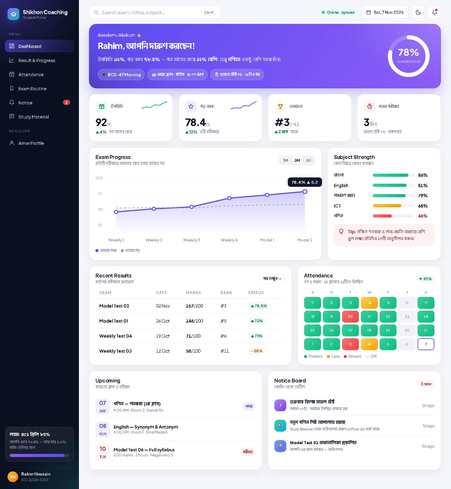
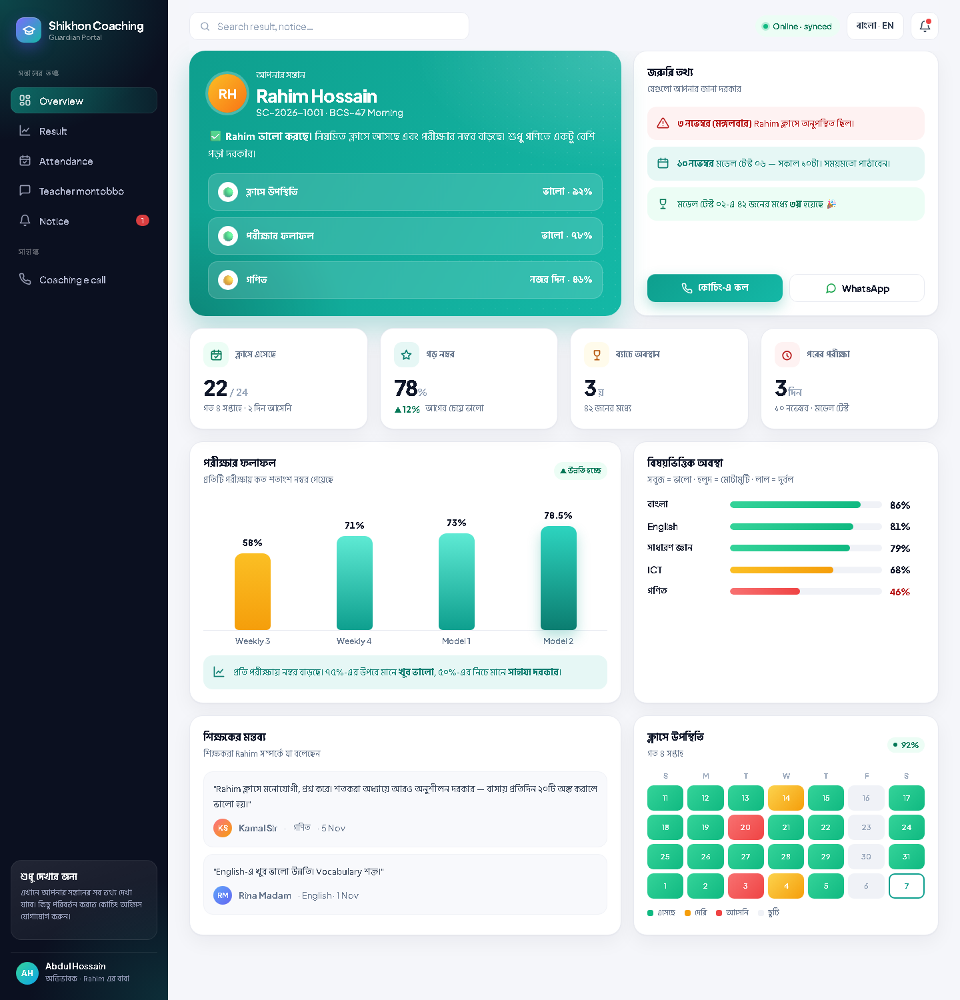
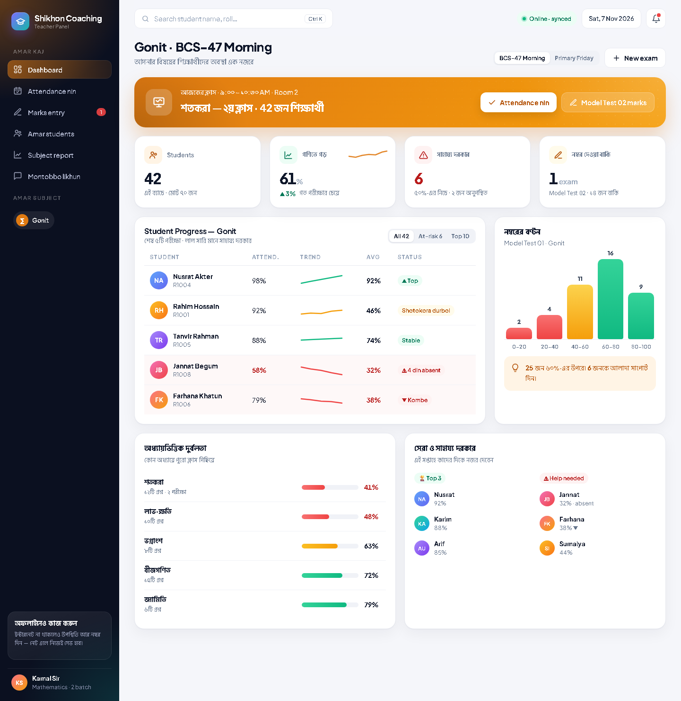
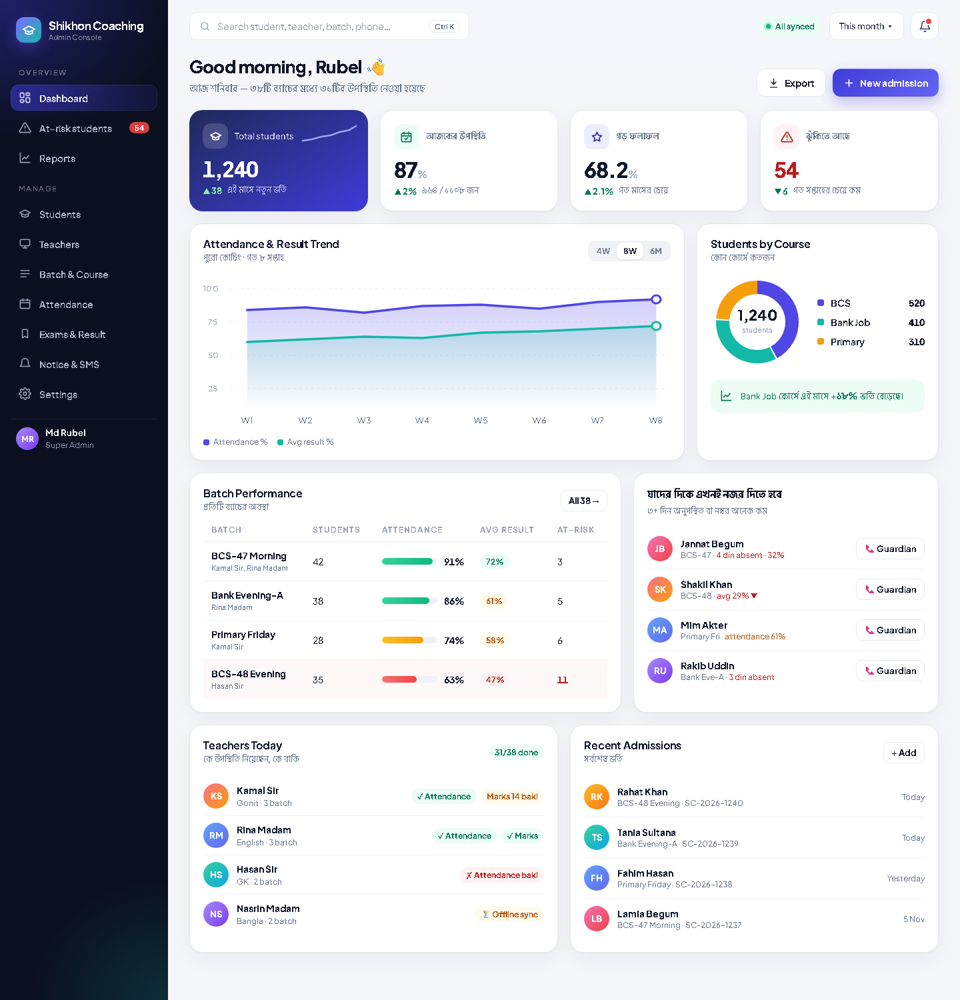
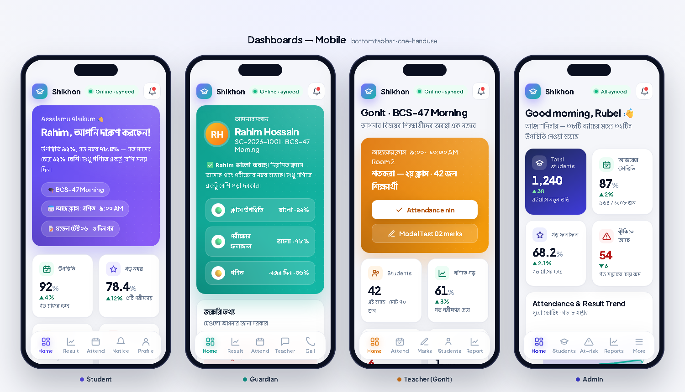
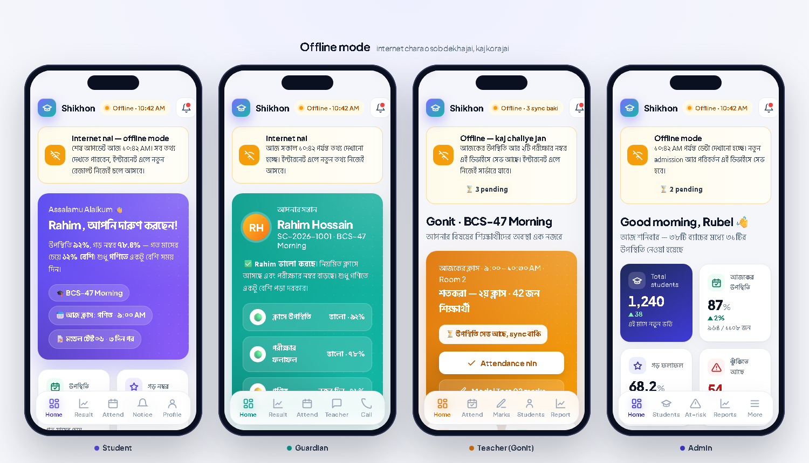
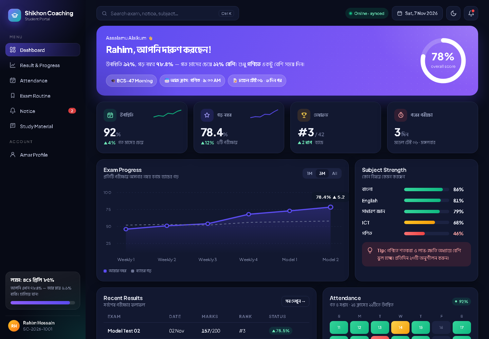

# Shikhon Coaching — Coaching Management System

Job preparation coaching center (BCS, Bank, Primary…) er jonno premium management app.
Protita student ke monitor kora jai — **Student, Guardian, Teacher, Admin** — 4 ta alada portal.
Computer ar mobile browser e chole, **internet chara o kaj kore** (PWA + offline sync).



## Ke ki dekhte pare

| Role | Login | Ki dekhbe / korbe |
|---|---|---|
| 🎓 **Student** | Student ID (`SC-2026-1001`) + password | Nijer attendance, protita exam er marks, merit rank, durbol subject + tips, upcoming exam, notice |
| 👨‍👩‍👦 **Guardian** | **Sontaner Student ID + 6 digit Guardian PIN** | Shudhu nijer sontaner sob kichu — shohoj Bangla verdict (🟢🟡🔴), absent alert, result, teacher er montobbo, coaching e call/WhatsApp |
| 📚 **Teacher** | Mobile + password | **Nijer subject** er student der progress (trend, distribution, top/help needed), attendance neya, nijer subject er marks entry, student ke montobbo |
| 🛡️ **Admin** | Email/mobile + password | Sob kichu — dashboard, at-risk list, student admission (CSV import), teacher + subject, batch/course, attendance, exam, notice |

**Auto monitoring:** attendance < 75%, 3+ din tana absent, avg marks < 50%, result kome jacche → at-risk list e chole ashe.

## Offline
- Mobile e "Add to Home screen" kore app er moto use kora jai.
- Internet na thakle teacher/admin attendance ar marks dite pare — data device e (IndexedDB) save hoy, net ashle **automatic sync** hoy (duplicate hoy na).
- Age dekha page gulo offline e o khule. Font, icon, chart sob app er moddhe — kono CDN lage na.
- Upore "Online · synced / Offline · 10:42 AM / 3 sync baki" status pill.

## Screenshots

| Guardian | Teacher | Admin |
|---|---|---|
|  |  |  |

| Mobile | Offline | Dark mode |
|---|---|---|
|  |  |  |

Design mockup (HTML) gulo [`docs/design/`](docs/design) folder e ache.

## Chalanor niyom

Lagbe: **Node.js 20+** ar ekta **Supabase** project (free plan e chole).

```bash
npm install
npm run setup:supabase      # Supabase er 2 ta connection line + DB password chabe, .env banabe, table + demo data dibe
npm run build
npm run start               # http://localhost:3000
```

Haate korte chaile: `.env.example` ke `.env` e copy kore Supabase → **Connect → ORMs → Prisma** theke `DATABASE_URL` ar `DIRECT_URL` boshan
(password e `%` `#` `?` `@` thakle URL-encode korte hobe), tarpor `npm run db:setup`.

**Supabase nirapotta:** `npm run db:setup` sob table e Row Level Security (RLS) chalu kore — Supabase er public Data API (anon key)
diye kono data pora/lekha jabe na; app shudhu nijer server theke Prisma diye database e jay. Notun table add korle `npm run db:secure` abar chalan.

Development: `npm run dev` (offline / service worker shudhu production build e chole).

### Demo login (password / PIN sobar: `123456`)

| Role | ID |
|---|---|
| Admin | `admin@shikhon.com` |
| Teacher (Math) | `01711111111` · English `01722222222` · GK `01733333333` · Bangla `01744444444` |
| Student | Student ID `2026-1001` … `2026-1030` |
| Guardian | Sontaner Student ID (jemon `2026-1008`) + PIN `123456` |

Notun student bhorti korle Student ID ar random Guardian PIN nijei toiri hoy (admin ekbar dekhte pan).
Student/teacher er default password = mobile number er shesh 6 digit.

## Real coaching e use korte
1. `.env` e lomba random `SESSION_SECRET` din (production e na dile app chalu hobe na).
2. `.env` e coaching er naam, phone, WhatsApp, address din (guardian ra dekhe).
3. Vercel (serverless) e deploy korle `DATABASE_URL` e `connection_limit=1` din; nijer server e `10` thik ache.
4. HTTPS e host korun (offline/PWA er jonno dorkar).
5. Demo data chara shuru korte `npx prisma db push` chalan, tarpor seed file theke shudhu admin user rekhe baki muche din.

## Tech
Next.js 15 (App Router) · TypeScript · Prisma + Supabase Postgres · Tailwind CSS v4 · custom SVG charts · Dexie (IndexedDB) · custom service worker · `next/font` (self-hosted Plus Jakarta Sans + Hind Siliguri)

## Folder
```
app/
  (auth)/login     4-role login
  student/         Student portal
  guardian/        Guardian portal
  teacher/         Teacher panel (subject-wise)
  admin/           Admin console
  api/sync         offline queue sync (idempotent)
components/        AppShell, charts, dashboard cards, attendance sheet, marks grid
lib/
  analytics.ts     attendance %, rank, trend, at-risk
  insights.ts      dashboard data for every role
  offline/         IndexedDB queue + sync
prisma/            schema + demo seed
public/sw.js       service worker (cache per build)
docs/              design mockups + screenshots
```
